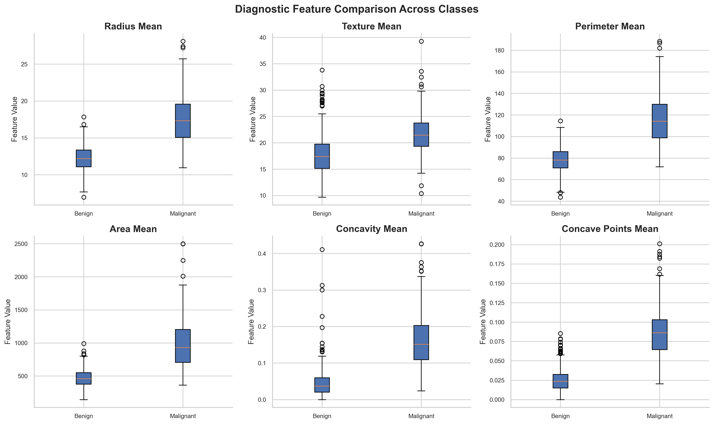
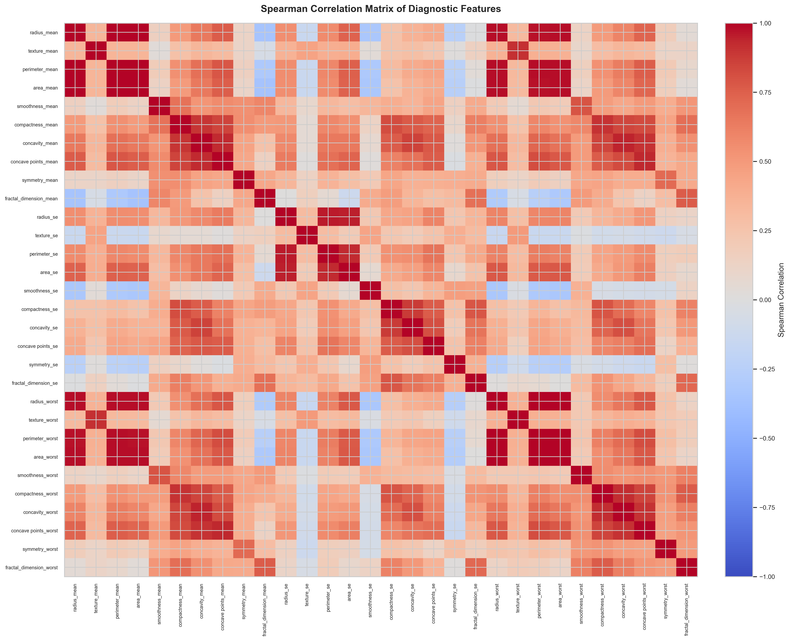
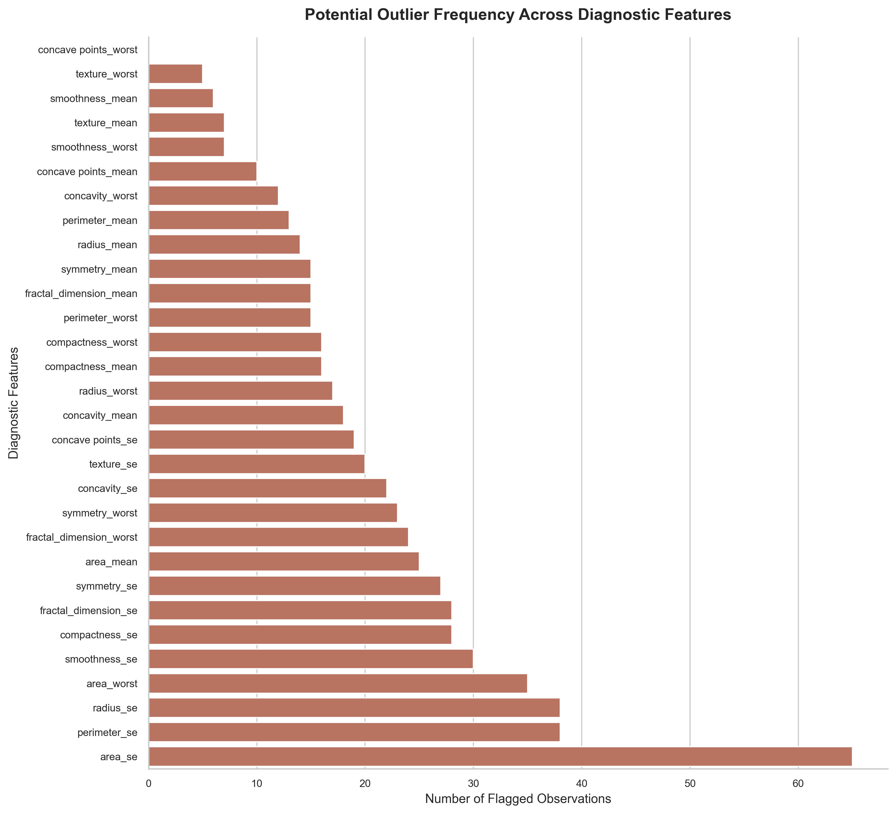
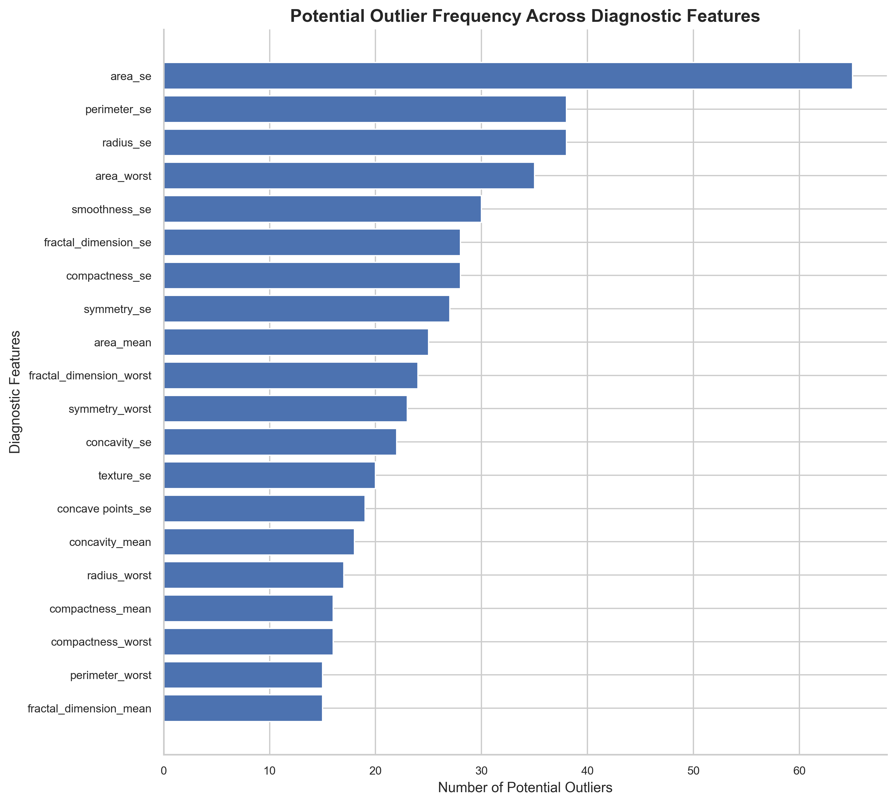

# Breast Cancer Detection & Diagnostic Intelligence

### An Explainable Machine Learning Framework for Breast Cancer Classification

**Statistical Analysis | Predictive Modeling | Feature Engineering | Explainable AI**

<p align="center">
  
</p>

<p align="center">
  
  
  
  
  
  
</p>

---

## Live Application

<p align="center">
  <a href="https://oncolens-breast-diagnostic.streamlit.app/">
    
  </a>
</p>

**Live demo:** https://oncolens-breast-diagnostic.streamlit.app/

Explore the interactive overview, single-sample analysis, batch laboratory, explainability and model methodology workspaces.

## Project Report

<p align="center">
  <a href="ONCOLENS_Report_Cinematic_Microscopy.pdf">
    
  </a>
</p>

**Technical report:** [ONCOLENS Breast Cancer Detection & Diagnostic Intelligence — Model Report (PDF)](ONCOLENS_Report_Cinematic_Microscopy.pdf)

The report summarizes the WDBC dataset, validation workflow, model-development methodology, recorded evaluation results and educational-use limitations.

---

## 01. Project Overview

Breast Cancer Detection & Diagnostic Intelligence is a machine learning project focused on investigating diagnostic measurements and developing predictive models to distinguish between benign and malignant breast tumors.

The project follows a structured data science workflow, beginning with dataset validation and statistical investigation, followed by exploratory data analysis, feature engineering, predictive modeling and model interpretability.

Rather than relying exclusively on classification accuracy, the framework emphasizes data quality, statistical relationships, feature redundancy, model reliability and the interpretation of predictive outcomes.

The objective is to develop a reproducible and interpretable classification pipeline supported by analytical methodology.

> **Research Disclaimer:** This project is intended for educational and research purposes. It is not a clinically validated diagnostic system and must not be used as a substitute for professional medical evaluation.

## 02. Project Objectives

- Establish a reproducible data validation pipeline.
- Investigate diagnostic feature distributions and statistical characteristics.
- Quantify differences between benign and malignant observations.
- Identify multicollinearity and redundant predictors.
- Investigate statistical outliers without automatically removing potentially meaningful observations.
- Develop meaningful feature representations and preprocessing strategies.
- Experiment with multiple machine learning classification algorithms.
- Evaluate predictive performance using appropriate classification metrics.
- Apply feature-importance techniques to understand model behavior.
- Develop an interactive interface for model inference.

## 03. Dataset Overview

**Dataset:** Wisconsin Diagnostic Breast Cancer (WDBC)

The dataset contains measurements computed from digitized images of fine needle aspirates (FNA) of breast masses.

| Dataset Attribute | Value |
|---|---:|
| Total observations | 569 |
| Predictor variables | 30 |
| Target variable | Diagnosis |
| Diagnostic classes | 2 |
| Benign observations | 357 |
| Malignant observations | 212 |
| Missing values | 0 |
| Duplicate observations | 0 |
| Duplicate identifiers | 0 |

### Diagnostic Class Distribution

| Diagnosis | Count | Percentage |
|---|---:|---:|
| Benign (B) | 357 | 62.74% |
| Malignant (M) | 212 | 37.26% |

### Feature Structure

The 30 numerical predictors are organized into three measurement categories:

| Category | Description |
|---|---|
| Mean | Average characteristics of cell nuclei |
| Standard Error | Measurement variability |
| Worst | Largest or most extreme measurements |

The measurements cover:

- Radius
- Texture
- Perimeter
- Area
- Smoothness
- Compactness
- Concavity
- Concave points
- Symmetry
- Fractal dimension

## 04. Data Integrity & Validation

Before statistical investigation, the dataset undergoes structural and integrity checks.

The validation process includes:

- Dataset dimensionality verification.
- Removal of completely empty columns.
- Missing-value assessment.
- Duplicate observation detection.
- Duplicate identifier detection.
- Target class verification.
- Numeric and finite predictor validation.
- Non-negative measurement checks.
- Predictor and target structure validation.

### Validation Results

| Integrity Check | Expected Result |
|---|---|
| Observations | 569 |
| Predictors | 30 |
| Missing values | 0 |
| Duplicate rows | 0 |
| Duplicate identifiers | 0 |
| Diagnosis labels | B / M |
| Dataset validation | PASSED on the supplied WDBC dataset |

The original dataset contains one completely empty column (`Unnamed: 32`), which is removed during cleaning.

The validated dataset is saved separately to preserve the distinction between raw and processed data.

## 05. Exploratory Data Analysis

Exploratory analysis investigates the statistical characteristics of diagnostic measurements and their relationships with the target variable.

### Analysis Performed

1. Dataset structure and descriptive statistics.
2. Diagnostic class distribution.
3. Feature distribution analysis.
4. Benign versus malignant comparison.
5. Spearman rank correlation analysis.
6. Multicollinearity investigation.
7. Inter-feature correlation ranking.
8. Outlier detection using the Interquartile Range (IQR) method.

### Key Analytical Findings

**Diagnostic Feature Separation**

Malignant observations exhibit higher average measurements across several geometric features.

| Feature | Benign Mean | Malignant Mean |
|---|---:|---:|
| Radius Mean | 12.1465 | 17.4628 |
| Texture Mean | 17.9148 | 21.6049 |
| Perimeter Mean | 78.0754 | 115.3654 |
| Area Mean | 462.7902 | 978.3764 |
| Concavity Mean | 0.0461 | 0.1608 |
| Concave Points Mean | 0.0257 | 0.0880 |

The differences in concavity and concave points are particularly notable, suggesting that these measurements may contain useful discriminatory information.

**Correlation Investigation**

Spearman correlation analysis identified substantial relationships between several diagnostic predictors.

| Feature Pair | Spearman Correlation |
|---|---:|
| radius_mean – area_mean | 0.9996 |
| radius_worst – area_worst | 0.9989 |
| radius_mean – perimeter_mean | 0.9978 |
| perimeter_mean – area_mean | 0.9971 |
| radius_worst – perimeter_worst | 0.9935 |
| perimeter_worst – area_worst | 0.9924 |

These relationships indicate considerable redundancy among certain geometric measurements.

**Outlier Investigation**

Potential outliers were identified using the IQR method.

The investigation revealed that `area_se` had the highest flagged observation count, followed by `radius_se` and `perimeter_se`.

Statistical outliers are not automatically treated as erroneous observations.

### EDA Visualization Gallery

The following visualizations are generated from the validated WDBC dataset.

**01. Diagnostic Class Distribution**


Distribution of benign and malignant observations across the dataset.

**02. Diagnostic Feature Comparison**



Boxplot comparison of six selected morphological measurements across diagnostic classes.

**03. Feature Correlation Analysis**



Spearman correlation matrix illustrating relationships and potential redundancy among the 30 diagnostic predictors.

**04. Feature Association with Diagnosis**



Top 15 diagnostic predictors ranked by absolute Spearman correlation with the binary target.

**05. Outlier Investigation**



IQR-based screening of potential outliers across numerical diagnostic features.

## 06. Project Architecture

```text
Breast-Cancer-Detection-ML/
│
├── app/
│   └── streamlit_app.py
│
├── data/
│   ├── raw/
│   │   └── wdbc.csv
│   │
│   └── processed/
│       └── wdbc_cleaned.csv
│
├── models/
│   ├── breast_cancer_logistic_regression.joblib
│   └── model_metadata.json
│
├── notebooks/
│   ├── 01_data_exploration.ipynb
│   └── 02_model_development.ipynb
│
├── outputs/
│   ├── eda/
│   └── model_evaluation/
│
├── src/
│   └── validate_data.py
│
├── .gitignore
├── requirements.txt
├── requirements-dev.txt
└── README.md
```

## 07. Technology Stack

| Area | Technologies |
|---|---|
| Programming | Python 3.10 |
| Data Manipulation | Pandas, NumPy |
| Statistical Analysis | SciPy |
| Data Visualization | Matplotlib, Seaborn |
| Machine Learning | Scikit-learn |
| Model Persistence | Joblib |
| Interactive Analysis | Jupyter Notebook |
| Application Development | Streamlit |
| Development Environment | VS Code |
| Version Control | Git, GitHub |

## 08. Machine Learning Development Roadmap

| Phase | Development Activity | Status |
|---|---|---|
| 01 | Environment and project setup | Completed |
| 02 | Dataset acquisition and validation | Completed |
| 03 | Exploratory data analysis | Completed |
| 04 | Statistical investigation and outlier screening | Completed |
| 05 | Preprocessing and model pipeline development | Completed |
| 06 | Model development and experimentation | Completed |
| 07 | Model evaluation and comparison | Completed — exploratory holdout |
| 08 | Feature-importance analysis | Completed |
| 09 | Interactive Streamlit application | Completed |
| 10 | Independent final evaluation and deployment hardening | Pending |

## 09. Model Evaluation Strategy

The model-development notebook evaluates multiple classifiers using stratified cross-validation and tunes selected candidates using the training data.

The selected Logistic Regression pipeline uses StandardScaler followed by Logistic Regression.

### Current Logistic Regression Results

| Evaluation Metric | Score |
|---|---:|
| Accuracy | 97.37% |
| Precision (Malignant) | 97.56% |
| Recall / Sensitivity (Malignant) | 95.24% |
| Specificity | 98.61% |
| F1-score | 96.39% |
| ROC-AUC | 0.9964 |

**Important evaluation limitation:** The notebook compares the tuned Logistic Regression and SVM candidates on the holdout test split and then selects Logistic Regression. Therefore, the holdout split has influenced model selection. These scores are exploratory estimates, not a fully untouched final generalisation estimate. A new untouched test set should be used for a rigorous final evaluation after model selection and threshold decisions are locked.

Particular attention is given to false-negative predictions because incorrectly classifying a malignant observation as benign is a critical error in this research context.

## 10. Explainable AI

Model interpretability is explored using saved feature-analysis outputs:

- Logistic Regression coefficient analysis.
- Permutation feature importance.
- Feature-importance comparison.

These techniques help examine how the fitted model responds to diagnostic predictors. Feature importance does not establish causation, and these analyses are not clinical explanations.

## 11. Installation and Setup

### Prerequisites

- Python 3.10 or newer.
- Git.
- Visual Studio Code (recommended).

The saved model was serialized with scikit-learn 1.7.2. The pinned runtime requirements help maintain compatibility.

### Clone the Repository

```bash
git clone https://github.com/nidhi-yadav20799/Breast-Cancer-Detection-ML.git
cd Breast-Cancer-Detection-ML
```

### Create and Activate a Virtual Environment

```bash
python -m venv .venv

# Windows
.venv\Scripts\activate

# macOS / Linux
# source .venv/bin/activate
```

### Install Dependencies

```bash
python -m pip install --upgrade pip
pip install -r requirements.txt
```

For notebook and EDA development:

```bash
pip install -r requirements-dev.txt
```

### Run Data Validation

If you need to regenerate the processed dataset, place the source WDBC CSV at `data/raw/wdbc.csv`, then run:

```bash
python src/validate_data.py
```

### Launch the Streamlit Application

```bash
streamlit run app/streamlit_app.py
```

## Project Status

Core dataset validation, exploratory analysis, model experimentation, saved model artifacts, feature-importance outputs and the Streamlit prototype are implemented.

Independent final evaluation, external validation, production deployment hardening and clinical validation remain outside the current project scope.

> **Disclaimer:** ONCOLENS is an educational machine-learning prototype. Model predictions are not medical diagnoses and must not be used for medical decision-making.
